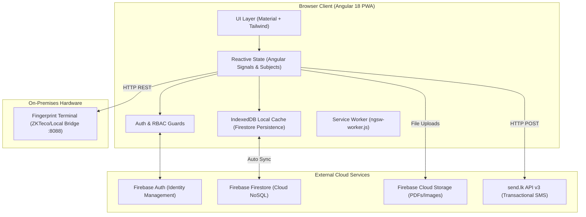
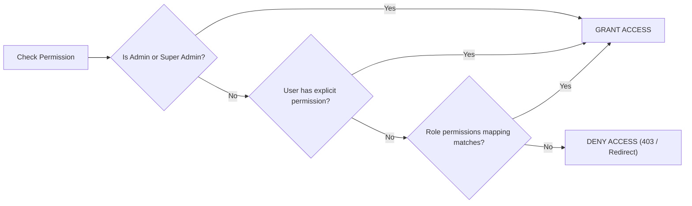
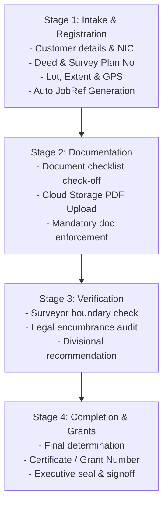

# Distributed Office Network Manager (DONM) — Comprehensive Technical & System Documentation

**Version:** 1.2.0  
**Target Domain:** Public Administration, Divisional Secretariats, Land Registries & Regional Departmental Branches  
**Technology Stack:** Angular 18 (Standalone, Signals), Google Firebase Firestore & Cloud Storage, Tailwind CSS, Angular Material 18, Nginx, Docker  

---

## Table of Contents
1. [Executive Overview & Core Mission](#1-executive-overview--core-mission)
2. [Architectural Principles & Offline-First Strategy](#2-architectural-principles--offline-first-strategy)
3. [Technology Stack & Core Dependencies](#3-technology-stack--core-dependencies)
4. [High-Level System Architecture](#4-high-level-system-architecture)
5. [Role-Based Access Control (RBAC) & Security Architecture](#5-role-based-access-control-rbac--security-architecture)
6. [Functional Modules Deep-Dive](#6-functional-modules-deep-dive)
   - [6.1 Executive Operations Dashboard](#61-executive-operations-dashboard)
   - [6.2 Citizen & Customer Registry](#62-citizen--customer-registry)
   - [6.3 Land Administration & Cadastral Operations](#63-land-administration--cadastral-operations)
   - [6.4 Work Plans & Monthly Operational Directives](#64-work-plans--monthly-operational-directives)
   - [6.5 Official Letters & Correspondence Registry](#65-official-letters--correspondence-registry)
   - [6.6 Biometric Attendance & Terminal Timesheet Engine](#66-biometric-attendance--terminal-timesheet-engine)
   - [6.7 SMS Communication Gateway (`send.lk` v3)](#67-sms-communication-gateway-sendlk-v3)
   - [6.8 Cryptographic Licensing & Software Activation Engine](#68-cryptographic-licensing--software-activation-engine)
   - [6.9 System Configuration & Dynamic Schema Engine](#69-system-configuration--dynamic-schema-engine)
   - [6.10 Audit Trails & Centralized System Logging](#610-audit-trails--centralized-system-logging)
7. [Database & Firestore NoSQL Schema Reference](#7-database--firestore-nosql-schema-reference)
8. [Directory Structure](#8-directory-structure)
9. [Local Development & Setup Guide](#9-local-development--setup-guide)
10. [Containerization, Nginx & Production Deployment](#10-containerization-nginx--production-deployment)
11. [Troubleshooting & Operational Best Practices](#11-troubleshooting--operational-best-practices)

---

## 1. Executive Overview & Core Mission

The **Distributed Office Network Manager (DONM)** is an enterprise web application designed to modernize, digitize, and automate operations in regional government offices, Divisional Secretariats (DS Offices), land registries, and multi-departmental administrative networks.

### Primary Objectives:
- **Resilient Offline-First Operations:** Ensure field officers, registry clerks, and regional staff can record tasks, register deeds, and update files without active internet access.
- **Cadastral Lifecycle Transparency:** Replace manual paper-based files with a 4-stage end-to-end digital lifecycle (Intake $\rightarrow$ Documentation $\rightarrow$ Field Verification $\rightarrow$ Sign-off/Grant).
- **Direct Citizen Engagement:** Automate milestone tracking notifications via integrated SMS gateways (SMS alerts sent at registration, document intake, and completion).
- **Operational Cadence & Accountability:** Manage monthly departmental work cycles (`YYYY-MM`), milestones, sequential verifications, and multi-officer dossiers.
- **Biometric Hardware Integration:** Bridge local fingerprint attendance hardware with cloud rosters to track presence, short leaves, and overtime.

---

## 2. Architectural Principles & Offline-First Strategy

### 2.1 Multi-Tab Offline Firestore Persistence
DONM initializes Firestore with `persistentLocalCache` and `persistentMultipleTabManager`:
```typescript
provideFirestore(() => {
  const app = initializeApp(environment.firebaseConfig);
  return initializeFirestore(app, {
    localCache: persistentLocalCache({ tabManager: persistentMultipleTabManager() })
  });
})
```
- **Local IndexedDB Caching:** Writes execute locally in milliseconds and queue in IndexedDB.
- **Automatic Reconnection Sync:** When connectivity is restored, mutations are streamed to Firebase Cloud and merged.
- **Zero In-Memory Disruption:** If a user performs an action while offline, the UI persists state locally (`localStorage` and IndexedDB) and displays informative offline toasts (`app-snackbar-offline`).

### 2.2 Angular Progressive Web App (PWA)
- **Service Worker (`ngsw-worker.js`):** Intercepts HTTP asset requests, caches JavaScript bundles, SCSS stylesheets, web fonts, and Material icon packs.
- **Cache-Busting for App Bundles:** Configured in `nginx.conf` with explicit headers (`Cache-Control: no-cache` for `index.html`, `ngsw.json`, and `ngsw-worker.js`; `max-age=31536000, immutable` for static hashes).

### 2.3 Secondary App Firebase Authentication Strategy
When an administrator creates a new staff user inside [`ProfileComponent`](file:///e:/Clone/OfficNetworkManager/src/app/features/profile/profile.component.ts), standard `createUserWithEmailAndPassword()` would inadvertently sign out the current admin. DONM initializes an isolated secondary Firebase app:
```typescript
const secondaryApp = initializeApp(environment.firebaseConfig, 'SecondaryApp');
const secondaryAuth = getAuth(secondaryApp);
const userCredential = await createUserWithEmailAndPassword(secondaryAuth, email, password);
// Save user document in primary Firestore
await secondaryAuth.signOut();
await deleteApp(secondaryApp);
```
This guarantees administrative sessions remain uninterrupted while registering new accounts.

---

## 3. Technology Stack & Core Dependencies

| Layer | Technology | Details |
| :--- | :--- | :--- |
| **Frontend Framework** | Angular 18 (v18.2.0) | Standalone Components, Signal-based reactivity, `@angular/core/rxjs-interop` |
| **Component Library** | Angular Material (v18.2.14) | Tables, Dialogs, Selects, Autocomplete, Badges, Tabs, Sidenav, Snackbars |
| **CSS & Design System** | Tailwind CSS + Custom SCSS | Inter typography, Slate/Deep Indigo government theme, CSS custom properties |
| **Cloud Database & Auth** | Google Firebase v10.12.0 / AngularFire v18 | Firestore Document DB, Firebase Auth, Cloud Storage |
| **Biometric Interface** | Local REST Bridge (`http://localhost:8088/api`) | Hardware fingerprint terminal integration, timesheet analytics |
| **SMS Gateway API** | `send.lk` REST API v3 | Sri Lankan phone number sanitization, transactional SMS notifications |
| **Cryptography Engine** | Pure-TS SHA-256 + WebCrypto `subtle.digest` | Dual-mode SHA-256 digital signature validation for activation `.key` files |
| **Reporting & Export** | SheetJS (`xlsx` v0.18.5) & Print Media CSS | Excel workbooks, A4 dossier print templates with automatic pagination |
| **Container & Proxy** | Docker & Nginx 1.27 Alpine | Multi-stage production container, Gzip compression, SPA fallback routing |

---

## 4. High-Level System Architecture



---

## 5. Role-Based Access Control (RBAC) & Security Architecture

Access control is managed through [`RbacService`](file:///e:/Clone/OfficNetworkManager/src/app/auth/rbac.service.ts) and [`rbacGuard`](file:///e:/Clone/OfficNetworkManager/src/app/auth/rbac.guard.ts), backed by the definition dictionary in [`permission.model.ts`](file:///e:/Clone/OfficNetworkManager/src/app/core/models/permission.model.ts).

### 5.1 System Roles Hierarchy
1. **Super Admin:** Unrestricted access across all modules, settings, role configurations, and activation keys.
2. **Divisional Admin:** Administrative oversight for regional operations (Land, Letters, Directives, Citizen registry, reports).
3. **Department Head:** Departmental authority, directive verification, and task approval.
4. **Staff:** Core operational staff performing routine data entry, letter drafting, and directive milestones.
5. **HR:** Staff records, attendance verification, payroll, and timesheets.
6. **Field Agent:** Mobile parcel inspection, customer intake, and field reports.

### 5.2 Granular Permission Structure
Permissions follow the scoped format: `<moduleId>:<actionKey>`:

```typescript
// Examples from SYSTEM_MODULE_PERMISSIONS:
'dashboard:view_overview'
'customers:create'
'customers:edit'
'land:view_parcels'
'land:register_deed'
'work-plans:view_tasks'
'work-plans:verify_signoff'
'work-plans:all_reports'
'letters:view_inward'
'letters:create_letter'
```

### 5.3 Dynamic Permission Resolution Order


---

## 6. Functional Modules Deep-Dive

### 6.1 Executive Operations Dashboard
- **Route:** `/dashboard`
- **Component:** [`DashboardComponent`](file:///e:/Clone/OfficNetworkManager/src/app/features/dashboard/dashboard.component.ts)
- **Key Functions:**
  - Aggregates high-level metrics: Total Allocated Funds, Total Registered Citizens, Pending Action Items.
  - Active Work Plan Directives table with filtering (In Progress, Completed, On Hold, Review).
  - Real-time Audit Activity feed streaming latest system operations from `system_logs`.
  - Officer-Specific Letter Inbox Widget: Displays urgent official correspondence dispatched to the logged-in user or their assigned department.

---

### 6.2 Citizen & Customer Registry
- **Route:** `/customers`
- **Service:** [`CustomerService`](file:///e:/Clone/OfficNetworkManager/src/app/features/customers/services/customer.service.ts)
- **Component:** [`CustomersComponent`](file:///e:/Clone/OfficNetworkManager/src/app/features/customers/customers.component.ts)
- **Key Functions:**
  - Citizen records management: Full Name, NIC, Mobile Phone, Address, Administrative Division, Grama Niladhari (GN) Division, Email, Active Status.
  - **Dynamic Fields:** Dynamically renders extra fields defined in the Settings module.
  - **Referential Integrity Protection:** `isCustomerLinked()` prevents deleting a customer profile if referenced in active land tasks (`land_jobs`) or cadastral ownership titles (`land_records`).

---

### 6.3 Land Administration & Cadastral Operations
- **Routes:** `/land/dashboard`, `/land/jobs`, `/land/reports`, `/land/audit`, `/land/settings`
- **Service:** [`LandService`](file:///e:/Clone/OfficNetworkManager/src/app/features/land/services/land.service.ts)
- **Models:** [`land.model.ts`](file:///e:/Clone/OfficNetworkManager/src/app/features/land/models/land.model.ts)
- **Cadastral 4-Stage Lifecycle:**



#### Automated Reference Numbering Engine
DONM generates standardized government file references:
$$\text{Reference Format: } \{\text{PREFIX}\}/\{\text{SUBJECT\_CODE}\}/\{\text{YYYY}\}/\{\text{FILE\_NUMBER}\}/\{\text{FILE\_VERSION}\}/\{\text{SEQ}\}$$
*Example:* `LND/04/2026/FN-01/V1/0042`

#### Cadastral Features:
- **Integrated Citizen SMS Alert:** Officers can trigger automated or custom SMS updates to the landowner's phone at each stage.
- **Audit Trails:** Dedicated collection `land_audit` tracks stage transitions, doc uploads, and approvals.
- **Reporting:** Export land logs and register sheets directly to Excel or printable format.

---

### 6.4 Work Plans & Monthly Operational Directives
- **Routes:** `/work-plans/dashboard`, `/work-plans/tasks`, `/work-plans/verification`, `/work-plans/calendar`, `/work-plans/reports`, `/work-plans/settings`
- **Service:** [`WorkPlanService`](file:///e:/Clone/OfficNetworkManager/src/app/features/work-plans/services/work-plan.service.ts)
- **Key Functions:**
  - **Operational Cadence (`assignedMonth`):** Work plans operate on monthly cycles (`YYYY-MM`).
  - **Multi-Stage Verification Pipeline:** Supports multi-level verification (Stage 1 Lead, Stage 2 Divisional Officer, Stage 3 Executive).
  - **Department Verification Quotas:** Automatically enforces required verifier counts per department (e.g., Surveying requires 2, Legal requires 2).
  - **Rollover Engine:** Unfinished tasks from previous months are detected (`isPlanCarriedOver()`) and marked with a Rollover Badge.
  - **A4 Officer Dossiers & Reports:** Generates structured A4 printable dossiers for whole-office master registers and individual officer files.
  - **Reassignment & Rollback:** Verifiers can send directives back to `In Progress` with revision comments.

---

### 6.5 Official Letters & Correspondence Registry
- **Routes:** `/letters/dashboard`, `/letters/inbox`, `/letters/actions`, `/letters/reports`, `/letters/audit`, `/letters/settings`
- **Service:** [`LetterService`](file:///e:/Clone/OfficNetworkManager/src/app/features/letters/services/letter.service.ts)
- **Key Functions:**
  - Inward & Outward postal logs, tracking incoming mail, sender agency, tracking numbers.
  - Workflow status transitions: `Received` $\rightarrow$ `Under Review` $\rightarrow$ `Action Required` $\rightarrow$ `Dispatched` $\rightarrow$ `Completed` $\rightarrow$ `Archived`.
  - Officer and Departmental inbox filtering.
  - Document attachments stored in Firebase Cloud Storage.
  - Full audit logging in `letter_audit`.

---

### 6.6 Biometric Attendance & Terminal Timesheet Engine
- **Route:** `/attendance`
- **Service:** [`AttendanceService`](file:///e:/Clone/OfficNetworkManager/src/app/core/services/attendance.service.ts)
- **Key Functions:**
  - Communicates with on-premise hardware bridge at `http://localhost:8088/api`.
  - **User Biometric Binding:** Maps system users (`user_finger_id`) to terminal biometric IDs.
  - **Timesheet Analytics:** Monthly summaries including Scheduled Work Days, Days Present, Days Absent, Half Days, Grace Periods Used, Short Leaves, Total Worked Hours, and Overtime.
  - **Daily Punch Inspection:** View individual in/out punch times with status badges.
  - **Excel Export:** One-click download of payroll attendance rosters.

---

### 6.7 SMS Communication Gateway (`send.lk` v3)
- **Service:** [`SmsService`](file:///e:/Clone/OfficNetworkManager/src/app/core/services/sms.service.ts)
- **Key Functions:**
  - **Sri Lankan Mobile Normalization:** Automatically standardizes input formats:
    $$\text{formatSriLankanPhoneNumber("0771234567")} \longrightarrow \text{"94771234567"}$$
  - **Dynamic Template Substitution:** Replaces `{CUSTOMER_NAME}`, `{JOB_REF}`, `{LOT_NUMBER}`, `{FILE_NUMBER}` into official notification texts.
  - **Delivery Logging:** Every SMS attempt (success/failure) is written to `sms_logs` with gateway response codes.

---

### 6.8 Cryptographic Licensing & Software Activation Engine
- **Service:** [`LicenseService`](file:///e:/Clone/OfficNetworkManager/src/app/core/services/license.service.ts)
- **Key Functions:**
  - Enforces deployment licensing without continuous internet connectivity.
  - **Dual SHA-256 Engine:**
    - High-performance `window.crypto.subtle.digest('SHA-256')` in Secure Contexts (HTTPS/localhost).
    - Pure TypeScript fallback SHA-256 implementation when accessing via direct LAN IP (e.g., `http://192.168.10.7:4200`) where `crypto.subtle` is unavailable.
  - **Key Format:** Supports both JSON `.key` files and base64 `ONM-ACT-...` activation strings.
  - **Status States:** `ACTIVE`, `EXPIRING_SOON` (7-day alert), `EXPIRED`, and `NOT_ACTIVATED`.

---

### 6.9 System Configuration & Dynamic Schema Engine
- **Route:** `/settings`
- **Service:** [`SettingsService`](file:///e:/Clone/OfficNetworkManager/src/app/features/settings/settings.service.ts)
- **Key Functions:**
  - **Dynamic Schemas:** Inject arbitrary custom fields (text, number, dropdown, date) into modules without code redeployment.
  - **Administrative Division Tree:** Configure Provinces, Districts, Divisional Secretariats, and Grama Niladhari (GN) divisions.
  - **Department Quotas:** Manage departments, lead officers, and verification quotas.
  - **Role-Permission Matrix:** Assign specific permissions to system roles dynamically.

---

### 6.10 Audit Trails & Centralized System Logging
- **Route:** `/system-log`
- **Service:** [`EventLogService`](file:///e:/Clone/OfficNetworkManager/src/app/core/services/event-log.service.ts)
- **Key Functions:**
  - Records administrative actions: `CREATED`, `UPDATED`, `DELETED`, `LOGIN`, and `SYSTEM`.
  - Non-blocking asynchronous logging to the `system_logs` collection.
  - Searchable and filterable by date, module, officer, and action type.

---

## 7. Database & Firestore NoSQL Schema Reference

### 7.1 `/users/{uid}`
```json
{
  "email": "officer@divsec.gov.lk",
  "displayName": "K. Silva",
  "department": "Land Administration & Titles",
  "user_finger_id": "104",
  "roles": ["Staff", "Divisional Admin"],
  "locations": ["Central", "North"],
  "accessible_modules": ["dashboard", "customers", "land", "work-plans", "letters"],
  "permissions": ["customers:create", "land:view_parcels"]
}
```

### 7.2 `/customers/{customerId}`
```json
{
  "name": "Sunil Gamage",
  "nic": "198214500123",
  "address": "45 Temple Road, Kegalle",
  "tpno": "0771234567",
  "division": "Central Division",
  "gnDivision": "GN-45B",
  "email": "sunil.g@example.com",
  "status": "active",
  "dynamic_data": {},
  "createdAt": 1774000000000,
  "updatedAt": 1774010000000
}
```

### 7.3 `/land_jobs/{jobId}`
```json
{
  "jobRef": "LND/04/2026/FN-01/V1/0001",
  "prefixCode": "LND",
  "subjectCode": "04",
  "fileNumber": "FN-01",
  "fileVersion": "V1",
  "jobTypeId": "jt_subdivision",
  "jobTypeName": "Land Sub-division / Partition",
  "priority": "Urgent",
  "status": "Verification",
  "customerName": "Sunil Gamage",
  "customerNic": "198214500123",
  "customerPhone": "0771234567",
  "customerAddress": "45 Temple Road, Kegalle",
  "deedNumber": "DEED-2024-998",
  "planNumber": "PL-5821",
  "lotNumber": "Lot 4B",
  "locationAddress": "Walpola Junction",
  "division": "Central Division",
  "documents": [
    {
      "docTypeId": "doc_deed",
      "docTypeName": "Original Title Deed",
      "isMandatory": true,
      "received": true,
      "status": "Uploaded",
      "fileUrl": "https://firebasestorage.googleapis.com/..."
    }
  ],
  "verificationStages": [
    {
      "stageId": "vs_field_survey",
      "stageName": "Physical Boundary Inspection",
      "assignedRole": "Surveyor",
      "status": "Approved",
      "checklistResults": [{ "item": "Verify boundary stones", "checked": true }]
    }
  ],
  "createdAt": 1774000000000,
  "createdBy": "K. Silva"
}
```

### 7.4 `/work_plans/{planId}`
```json
{
  "title": "Digitization of Cadastral Folios",
  "description": "Scan and link historical folio volumes to digital records",
  "division": "Central Division",
  "department": "Land Administration & Titles",
  "category": "Land Deeds",
  "leadName": "K. Silva",
  "leadEmail": "k.silva@divsec.gov.lk",
  "ownerName": "T. Bandara",
  "ownerEmail": "t.bandara@divsec.gov.lk",
  "status": "In Progress",
  "priority": "High",
  "progress": 65,
  "budget": 250000,
  "startDate": "2026-09-01",
  "targetDate": "2026-09-30",
  "assignedMonth": "2026-09",
  "milestones": [
    { "id": "m1", "title": "Index 500 folios", "completed": true },
    { "id": "m2", "title": "Quality check", "completed": false }
  ],
  "verifiers": [
    {
      "id": "v1",
      "order": 1,
      "name": "K. Silva",
      "email": "k.silva@divsec.gov.lk",
      "verified": true,
      "verifiedAt": 1774020000000
    }
  ]
}
```

### 7.5 `/official_letters/{letterId}`
```json
{
  "ref_number": "LET/2026/089",
  "title": "Notice of Land Acquisition - Highway Expansion",
  "type": "Inward",
  "priority": "Urgent",
  "status": "Action Required",
  "received_from": "Road Development Authority (RDA)",
  "received_date": "2026-10-15",
  "send_to": ["Land Administration & Titles"],
  "assigned_to": ["officer_uid_123"],
  "assigned_user_names": ["K. Silva"],
  "action_logs": [
    {
      "id": "act_1",
      "timestamp": 1774000000000,
      "officer_name": "Registrar Clerk",
      "from_status": "Received",
      "to_status": "Action Required",
      "remarks": "Assigned to Land Branch for urgent report"
    }
  ]
}
```

---

## 8. Directory Structure

```
OfficNetworkManager/
├── angular.json                 # Angular CLI workspace configuration
├── package.json                 # NPM dependencies and build scripts
├── tsconfig.json                # TypeScript compiler config
├── nginx.conf                   # Production Nginx reverse proxy configuration
├── Dockerfile                   # Multi-stage production container image
├── docker-compose.yml           # Compose service file (Ports 4200, 8088)
├── deploy.ps1                   # Automated remote deployment PowerShell script
├── public/                      # Static assets & icons
└── src/
    ├── app/
    │   ├── auth/                # Login, Auth Guards & RBAC Service
    │   ├── core/
    │   │   ├── animations/      # Angular route animations
    │   │   ├── models/          # Permission dictionaries & types
    │   │   └── services/        # Firestore, Licensing, SMS, Attendance, Logs
    │   ├── features/
    │   │   ├── attendance/      # Biometric attendance & timesheets
    │   │   ├── customers/       # Citizen directory & dynamic forms
    │   │   ├── dashboard/       # Operations dashboard & KPI telemetry
    │   │   ├── hr/              # Staff directory & personnel
    │   │   ├── land/            # Cadastral parcels, 4-stage wizard & audit
    │   │   ├── letters/         # Inward/outward official letter tracking
    │   │   ├── profile/         # User profile & administrative account setup
    │   │   ├── settings/        # System configuration, schemas, divisions
    │   │   ├── system-log/      # Centralized event logging
    │   │   └── work-plans/      # Directives, kanban, rollover, verification
    │   ├── layout/              # Header, Sidebar, Main Layout wrapper
    │   └── shared/              # Reusable components (e.g. ConfirmDialog)
    ├── environments/            # Firebase config and environment settings
    └── styles.scss              # Global design system & print styles
```

---

## 9. Local Development & Setup Guide

### Prerequisites
- **Node.js:** v18.x or v20.x LTS
- **NPM:** v9.x or higher
- **Angular CLI:** `npm install -g @angular/cli@18`

### Step 1: Install Dependencies
```powershell
npm install
```

### Step 2: Configure Environment
Verify `src/environments/environment.ts` contains your Firebase project configuration credentials.

### Step 3: Run Development Server
```powershell
npm start
```
Navigate to `http://localhost:4200/`. The application will hot-reload automatically upon source file changes.

### Step 4: Run Tests
```powershell
npm test
```

---

## 10. Containerization, Nginx & Production Deployment

### 10.1 Production Build
Compile production bundles to `dist/donm/browser`:
```powershell
npm run build
```

### 10.2 Docker Container Build & Run
Build the lightweight Alpine Nginx image:
```powershell
docker build -t officnetworkmanager:latest .
docker compose up -d
```
The application will be served at `http://localhost:4200` (mapped to port 80).

### 10.3 Automated Server Deployment (`deploy.ps1`)
To deploy to a production Linux server (e.g., `192.168.10.7`):
```powershell
.\deploy.ps1 -ServerIp "192.168.10.7" -Username "root" -Password "YourPassword"
```
The script automatically:
1. Compiles the Angular production bundles.
2. Packages the build artifacts, Nginx configs, and Dockerfile into a tarball.
3. Securely copies the archive to the remote server via PSCP.
4. Unpacks and triggers `docker compose up -d --build --force-recreate` via Plink.

---

## 11. Troubleshooting & Operational Best Practices

### 1. Biometric Attendance Shows "Server Offline"
- **Cause:** The local biometric terminal agent running at `http://localhost:8088/api` is not running.
- **Resolution:** Start the on-premise biometric sync agent on the local PC or update the `apiUrl` in [`AttendanceService`](file:///e:/Clone/OfficNetworkManager/src/app/core/services/attendance.service.ts).

### 2. SMS Dispatch Failures
- **Cause:** Invalid phone number format or expired gateway token.
- **Resolution:** Verify the phone number begins with `07` or `947`. Verify the `apiToken` in **Settings $\rightarrow$ SMS Gateway** matches your active `send.lk` account.

### 3. Application Shows "License Expired" or "Not Activated"
- **Cause:** Software activation key has expired or signature hash failed verification.
- **Resolution:** Log in as Super Admin, navigate to **Settings $\rightarrow$ System License**, generate a new activation `.key` or token for the organization, and click **Activate Platform**.

### 4. Firestore Permission Denied (403)
- **Cause:** Firebase security rules require an authenticated user or role claim.
- **Resolution:** Verify the user is authenticated via Firebase Auth and their document exists in the `/users` collection with appropriate role definitions.
