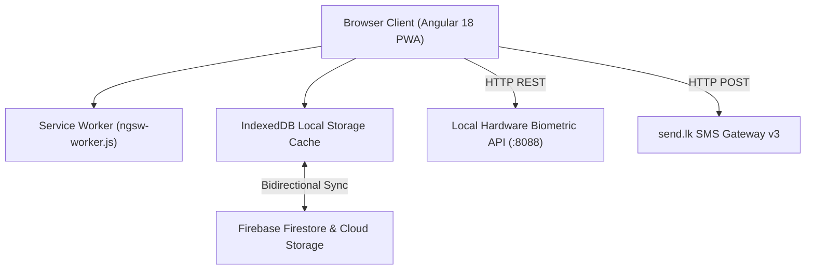

# Distributed Office Network Manager (DONM)

[](https://angular.dev/)
[](https://firebase.google.com/)
[](https://tailwindcss.com/)
[](https://www.docker.com/)
[](#)

An enterprise-grade, offline-first web platform engineered for public sector administration, Divisional Secretariats (DS Offices), regional land registries, and multi-departmental government branch networks.

---

## 📖 Official Documentation & User Guide

> [!IMPORTANT]
> - **Operational User Manual:** For detailed day-to-day operating instructions, refer to the [USER_GUIDE.md](file:///e:/Clone/OfficNetworkManager/USER_GUIDE.md).
> - **Technical & Architecture Specification:** For in-depth system architecture, Firestore NoSQL schemas, RBAC permission matrices, deployment guides, and containerization setup, consult [DOCUMENTATION.md](file:///e:/Clone/OfficNetworkManager/DOCUMENTATION.md).

---

## 🌟 Key Capabilities

- 📡 **Offline-First & Auto-Sync:** Built with Firestore IndexedDB multi-tab persistent cache (`persistentLocalCache`) and Angular Service Worker PWA. Perform write actions offline without losing data; the app automatically synchronizes upon reconnection.
- 💰 **Account Management (Customers & Vouchers):** Unified financial accounting and citizen registry. Manage payment vouchers (PV), receipts (RV), petty cash (PCV), customer/payee linking, printable government certificates with signature blocks, and Excel exports.
- 🗺️ **Cadastral & Land Management:** Complete 4-stage digital workflow (Intake $\rightarrow$ Documentation $\rightarrow$ Field Verification $\rightarrow$ Completion/Grants) with automated government file reference formatting (`{PREFIX}/{SUBJECT_CODE}/{YYYY}/{FILE_NUMBER}/{FILE_VERSION}/{SEQ}`).
- 📋 **Monthly Operational Directives (Work Plans):** Monthly cycles (`YYYY-MM`), milestones, sequential verifications, department-specific quotas, rollover tracking for carried-over tasks, and A4 printable dossiers.
- 📨 **Official Letters & Dispatch Registry:** Manage inward/outward communications, document routing, departmental assignments, and Cloud Storage attachments.
- 👥 **Citizen & Customer Registry:** Centralized citizen directory with National Identity Card (NIC) verification, division tags, and referential protection against orphan deletions.
- 📱 **Automated SMS Gateway:** Deep integration with `send.lk` v3 REST API for real-time citizen status notifications with dynamic template parameter substitution.
- ⏱️ **Biometric Terminal Integration:** Interfacing with local biometric fingerprint hardware (`:8088/api`) to track shifts, daily punch times, attendance percentages, and export payroll timesheets to Excel.
- 🔐 **Cryptographic Licensing Engine:** Dual SHA-256 digital signature validation (WebCrypto `subtle.digest` & fallback pure-TS SHA-256) for offline license file activation (`.key`).
- 🛡️ **Multi-Tier RBAC & Audit Trails:** Granular permissions across 6 role tiers with comprehensive immutable event logging.

---

## 🚀 Quick Start

### 1. Installation
```powershell
# Clone the repository
git clone <repo-url>
cd OfficNetworkManager

# Install dependencies
npm install
```

### 2. Development Server
```powershell
npm start
```
Navigate to `http://localhost:4200/`. The application will hot-reload automatically on code modifications.

### 3. Production Build
```powershell
npm run build
```
Production artifacts will be placed in `dist/donm/browser`.

### 4. Run via Docker
```powershell
docker compose up -d --build
```
Access the application on `http://localhost:4200` or `http://localhost:8088`.

### 5. Automated Server Deployment
```powershell
.\deploy.ps1 -ServerIp "192.168.10.7" -Username "root" -Password "YourPassword"
```

---

## 🏛️ System Architecture



---

## 📚 Module Overview

| Module | Route | Primary Responsibilities |
| :--- | :--- | :--- |
| **Executive Dashboard** | `/dashboard` | Operational KPIs, active tasks, letter alerts, recent audit telemetry |
| **Account: Customers** | `/customers` or `/account/customers` | Citizen profiles, NIC records, dynamic custom fields, linked land checks |
| **Account: Vouchers** | `/vouchers` or `/account/vouchers` | Payment vouchers, receipts, disbursements, payee linking, print certificate, Excel export |
| **Land Administration** | `/land` | 4-Stage Cadastral workflow, deed/plan tracking, automated references, SMS alerts |
| **Work Plans** | `/work-plans` | Monthly directives, verifier pipelines, rollover engine, Kanban, A4 dossiers |
| **Official Letters** | `/letters` | Inward/Outward registry, departmental dispatch, file attachments |
| **Attendance & Biometrics** | `/attendance` | Hardware terminal sync, fingerprint binding, monthly timesheets |
| **System Settings** | `/settings` | Dynamic schemas, administrative divisions, department quotas, SMS config, licensing |
| **System Audit Log** | `/system-log` | Immutable platform activity logs |
| **User Profile & Admin** | `/profile` | User preferences, multi-tier role assignment, account creation |

---

## 📄 Documentation Reference

- **[USER_GUIDE.md](file:///e:/Clone/OfficNetworkManager/USER_GUIDE.md)** — Step-by-step user manual for clerks, finance officers, land officers, and department heads.
- **[DOCUMENTATION.md](file:///e:/Clone/OfficNetworkManager/DOCUMENTATION.md)** — Comprehensive technical manual, architecture diagrams, Firestore schemas, and deployment instructions.
