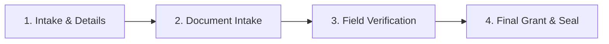

# Distributed Office Network Manager (DONM) — Comprehensive End-User Guide & Operations Manual

**Document Version:** 1.2.0  
**Target Audience:** Front-Desk Clerks, Accounts & Finance Officers, Cadastral & Land Officers, Department Heads, Divisional Secretaries, and System Administrators.

---

## Table of Contents
1. [Introduction & Overview](#1-introduction--overview)
2. [Getting Started & Authentication](#2-getting-started--authentication)
3. [Navigating the Workspace](#3-navigating-the-workspace)
4. [Account Management](#4-account-management)
   - [4.1 Citizen & Customer Directory](#41-citizen--customer-directory)
   - [4.2 Vouchers & Financial Disbursements](#42-vouchers--financial-disbursements)
5. [Land Administration & Cadastral Operations](#5-land-administration--cadastral-operations)
   - [5.1 The 4-Stage Cadastral Workflow](#51-the-4-stage-cadastral-workflow)
   - [5.2 Sending Citizen SMS Updates](#52-sending-citizen-sms-updates)
   - [5.3 Cadastral Reports & Audits](#53-cadastral-reports--audits)
6. [Work Plans & Monthly Operational Directives](#6-work-plans--monthly-operational-directives)
   - [6.1 Understanding Monthly Cycles & Rollover](#61-understanding-monthly-cycles--rollover)
   - [6.2 Authoring Tasks & Milestones](#62-authoring-tasks--milestones)
   - [6.3 Multi-Stage Sequential Verification](#63-multi-stage-sequential-verification)
   - [6.4 Generating A4 Reports & Officer Dossiers](#64-generating-a4-reports--officer-dossiers)
7. [Official Letters & Correspondence Registry](#7-official-letters--correspondence-registry)
   - [7.1 Inward & Outward Correspondence Logging](#71-inward--outward-correspondence-logging)
   - [7.2 Document Routing & Attachment Uploads](#72-document-routing--attachment-uploads)
   - [7.3 Status Lifecycle & Audit Trail](#73-status-lifecycle--audit-trail)
8. [HR & Personnel Directory](#8-hr--personnel-directory)
9. [Biometric Attendance & Terminal Timesheets](#9-biometric-attendance--terminal-timesheets)
   - [9.1 Linking Staff to Fingerprint Terminals](#91-linking-staff-to-fingerprint-terminals)
   - [9.2 Reviewing Monthly Summaries & Daily Timesheets](#92-reviewing-monthly-summaries--daily-timesheets)
   - [9.3 Exporting Payroll Attendance to Excel](#93-exporting-payroll-attendance-to-excel)
10. [System Settings & Administrative Configuration](#10-system-settings--administrative-configuration)
    - [10.1 Dynamic Custom Schemas](#101-dynamic-custom-schemas)
    - [10.2 Administrative Divisions & Departments](#102-administrative-divisions--departments)
    - [10.3 SMS Gateway Configuration](#103-sms-gateway-configuration)
    - [10.4 Platform Activation & Cryptographic Licensing](#104-platform-activation--cryptographic-licensing)
11. [System Audit Logs](#11-system-audit-logs)
12. [Offline-First Operations Guide](#12-offline-first-operations-guide)
13. [Frequently Asked Questions (FAQ) & Troubleshooting](#13-frequently-asked-questions-faq--troubleshooting)

---

## 1. Introduction & Overview

The **Distributed Office Network Manager (DONM)** is a comprehensive public administration management system. It unites accounts, citizen records, land registration, operational directives, correspondence, and biometric attendance into a unified, secure platform.

### Core Capabilities:
- **Offline Resilience:** Continue working even during internet dropouts. Data is safely written to your browser's persistent database and automatically synced to the cloud when connectivity returns.
- **Role-Based Access Control (RBAC):** Tailored views ensuring officers see and approve only actions matching their assigned responsibilities.
- **Automated Citizen Notifications:** Instant SMS updates sent directly to citizens' mobile phones at key milestones.
- **Audit Compliance:** Every critical action is timestamped and recorded in permanent audit logs.

---

## 2. Getting Started & Authentication

### 2.1 Logging In
1. Open your web browser and navigate to the application URL (e.g. `http://localhost:4200` or your regional office server IP).
2. Enter your government-assigned **Email Address** and **Password**.
3. Click **Sign In to Portal**.
4. Upon successful authentication, you will be directed to the **Executive Overview Dashboard**.

> [!TIP]
> If you are working offline, your previously authenticated session remains valid on that computer, allowing you to access cached records.

### 2.2 Updating Your Profile & Fingerprint ID
1. In the left sidebar, click **User Profiles & RBAC** (or navigate to `/profile`).
2. Under the **My Personal Profile** tab:
   - Verify your **Display Name**.
   - Select your primary **Department / Branch** (e.g., *Land Administration & Titles*, *Accounts*, *Planning & Urban Development*).
   - Enter your **Biometric Fingerprint Hardware ID** (e.g., `104`) as configured on your office fingerprint terminal.
3. Click **Save Profile Changes**.

---

## 3. Navigating the Workspace

The portal features a clean, responsive layout designed for high productivity:

### 3.1 The Top Header Bar
- **Current Office / Department:** Displays your assigned operational branch.
- **Search & Quick Telemetry:** Access notifications and urgent alerts.
- **User Chip & Sign Out:** View logged-in credentials and access one-click logout.

### 3.2 The Collapsible Sidebar
The sidebar is structured into functional operational groups:
- **MAIN DASHBOARD:**
  - `Overview` — High-level KPI cards, recent activity feed, and pending tasks.
- **OPERATIONS:**
  - `Customers` — Citizen profiles, corporate stakeholders, and identity records.
  - `Account` — Financial management group with **Vouchers** (Payment & Receipt vouchers).
  - `Land Management` — Expandable group with **Dashboard**, **Job List**, **Reports**, **Audit**, and **Settings**.
  - `Work Plans` — Expandable group with **Dashboard**, **Verification**, **Task List**, **Calendar**, **Reports**, and **Settings**.
  - `Official Letters` — Expandable group with **Dashboard**, **Inbox**, **Actions**, **Reports**, **Audit**, and **Settings**.
  - `HR Directory` — Staff telephone lists and departmental assignments.
- **ADMINISTRATION:** (Visible to Administrators)
  - `User Profiles & RBAC` — Staff accounts, role assignments, and permission overrides.
  - `User Attendance` — Biometric terminal synchronizer and monthly timesheet viewer.
  - `Settings & Schemas` — Dynamic fields, administrative divisions, and licensing.
  - `System Audit Log` — Complete platform activity history.

---

## 4. Customer Directory & Account Management

### 4.1 Citizen & Customer Directory
**Route:** `/customers` (or Sidebar $\rightarrow$ **Customers**)

The Citizen Registry is the central database of all applicants, landowners, contractors, and corporate stakeholders.

#### A. Searching & Filtering Citizens
- Type any portion of a citizen's **Name**, **National Identity Card (NIC)**, **Mobile Number**, or **Division** into the search field.
- The directory filters instantly as you type.

#### B. Registering a New Citizen / Customer
1. Click the **+ Register Customer** button in the top right.
2. Complete the required fields in the modal:
   - **Full Legal Name:** (e.g., *Sunil Gamage*)
   - **NIC / Passport Number:** (e.g., *198214500123* or *821450123V*)
   - **Primary Contact Number:** (e.g., *0771234567*)
   - **Residential / Postal Address:** (e.g., *45 Temple Road, Kegalle*)
   - **Administrative Division:** Select from your regional secretariat divisions.
   - **Grama Niladhari (GN) Division:** (e.g., *GN-45B Walpola*)
   - **Email Address (Optional):** For electronic receipts.
   - **Status:** Set to `Active`.
3. If custom dynamic fields have been configured (e.g., *Tax File Number*), enter the values accordingly.
4. Click **Save Customer**.

#### C. Referential Integrity Protection (Safe Deletion)
> [!IMPORTANT]
> The system strictly prevents accidental deletion of customer records if they are currently linked to an active **Land Job** (`land_jobs`) or registered **Land Title** (`land_records`). If you attempt to delete a linked citizen, the system will block the deletion and display an alert to protect official legal records.

---

### 4.2 Vouchers & Financial Disbursements
**Route:** `/vouchers` (or Sidebar $\rightarrow$ **Account** $\rightarrow$ **Vouchers**)

The Vouchers module manages public expenditure, vendor payments, petty cash, and citizen receipt vouchers.

#### A. Overview of Voucher Types
| Voucher Type | Code | Typical Use Case |
| :--- | :--- | :--- |
| **Payment Voucher** | `PV` | Official disbursements, contractor payments, legal compensation, supplier invoices |
| **Receipt Voucher** | `RV` | Revenue intake, land tax payments, deed copy fees, application fees |
| **Petty Cash Voucher** | `PCV` | Daily minor office expenditures, postal stamps, incidental expenses |
| **Journal Voucher** | `JV` | Inter-account ledger adjustments, fund re-allocations |

#### B. Financial KPI Vitals
At the top of the Vouchers dashboard, monitor real-time accounting vitals:
- **Total Disbursed (Paid):** Certified aggregate sum of all processed payments.
- **Pending Approval:** Number of vouchers awaiting administrative signature.
- **Approved (Ready for Payment):** Vouchers authorized for cashier disbursement.
- **Total Vouchers Registered:** Grand ledger count across all classifications.

#### C. Creating a New Voucher
1. Click **+ New Voucher**.
2. **Voucher Details:**
   - **Voucher Number:** Automatically generated (e.g., `PV/2026/4821`). You can adjust this if using pre-printed government voucher books.
   - **Voucher Type:** Choose *Payment Voucher*, *Receipt Voucher*, *Petty Cash*, or *Journal Voucher*.
   - **Voucher Date:** Defaults to today's date.
   - **Status:** Select *Draft* (if incomplete) or *Pending Approval*.
3. **Payee & Beneficiary Selection (Typeahead Autocomplete & On-the-Fly Registration):**
   - **Typeahead Search:** Start typing any citizen's Name, NIC, or Mobile Phone in the payee search box. The system displays matching registered citizens in real time with their NIC badges and contact numbers. Selecting an option automatically populates their details and links their profile.
   - **On-the-Fly Customer Registration:** If the citizen or payee is not yet in the system, you do **not** need to leave the screen:
     - Click **+ Add New Customer** (or select the `+ Register "[Typed Name]" as New Customer...` option from the typeahead dropdown).
     - Enter the citizen's Full Name, NIC, Mobile Phone, Address, and Division.
     - With **"Automatically save citizen to central Citizen Registry database"** checked, the system registers the citizen to the master registry and links them to this voucher upon saving!
4. **Financial Particulars:**
   - **Total Amount (LKR):** Enter the numerical amount (e.g., `125000.00`).
   - **Payment Method:** Choose *Cash Payment*, *Official Cheque*, *Direct Bank Transfer*, or *Online / Card*.
   - **Cheque / Reference Number:** Enter the cheque leaf number or transaction reference.
   - **Bank & Branch Name:** (e.g., *Bank of Ceylon - Kegalle Branch*).
   - **Particulars / Reason:** Specify the exact project or invoice description.
5. Click **Create Voucher** (or **Register Customer & Create Voucher**).
5. Click **Create Voucher**.

#### D. Viewing & Printing Official Vouchers
1. In the Vouchers table, click the **View (Eye Icon)** button next to any voucher.
2. The system opens the **Official Government Voucher Certificate**:
   - Formatted with institutional header, emblem, reference numbers, and payee summary.
   - Clear disbursement particulars and currency breakdown.
   - Designated signature blocks: *Prepared By*, *Checked & Verified*, *Approved By*, and *Received By (Payee)*.
3. Click **Print Voucher** to print or export directly to PDF.

#### E. Approving & Disbursing Vouchers
- **To Approve:** Department Heads and Administrators can open the voucher detail modal and click **Approve Voucher**. The status shifts to `Approved`.
- **To Mark as Paid:** When the cashier disburses cash or issues the cheque, open the approved voucher and click **Mark as Paid / Disbursed**. The disbursement timestamp is recorded.

#### F. Exporting Ledger to Excel
Click **Export Excel** at the top right to download a spreadsheet containing all filtered vouchers, amounts, reference numbers, and authorization timestamps.

---

## 5. Land Administration & Cadastral Operations
**Route:** `/land/jobs` (or Sidebar $\rightarrow$ **Land Management**)

The Land module handles cadastral land partitions, boundary dispute surveys, deed title registrations, and crown land alienation through a strict 4-stage process.

---

### 5.1 The 4-Stage Cadastral Workflow

#### Stage 1: Intake & Cadastral Registration
1. Click **+ New Land Job** to launch the creation wizard.
2. **Job Classification:** Choose a job type (e.g. *Land Sub-division / Partition*, *Boundary Demarcation*, *Deed Transfer*).
3. **Customer Linking:** Search for a citizen by NIC or name to auto-fill applicant details.
4. **Cadastral Plot Identifiers:**
   - **Deed Number & Volume**
   - **Surveyor Cadastral Plan Number**
   - **Lot / Parcel Number**
   - **Extent / Size** (e.g., *0A-1R-20P* or *500 sq.m*)
   - **Physical Location Address** & **Grama Niladhari Division**
   - **GPS Coordinates (Optional):** Latitude/Longitude.
5. **Government Reference Number:** The system automatically formats your official reference:
   $$\text{Ref: } \text{LND/04/2026/FN-01/V1/0023}$$
6. Click **Next** to proceed to documentation.

#### Stage 2: Documentation Checklist & File Upload
1. Review the required document checklist for this job type:
   - *Original Title Deed / Certified Extract* (Mandatory)
   - *Cadastral Survey Plan* (Mandatory)
   - *National Identity Card (NIC) Copy* (Mandatory)
   - *Local Council Non-Vesting Clearance*
2. Mark the **Received** checkbox as the applicant hands over physical documents.
3. Click the upload button to attach PDF scans or high-resolution photos of deeds and survey plans.
4. Click **Next** to proceed to field verification.

#### Stage 3: Field Verification & Inspections
1. Assigned officers (e.g., *Licensed Surveyor*, *Legal Officer*, *Field Officer*) execute their verification tasks.
2. Complete the mandatory inspection checklist items:
   - *Verify existing boundary landmarks and corner stones*
   - *Ensure minimum access road width complies with planning guidelines*
   - *Check 30-year unbroken chain of title folios*
3. Enter written inspection findings and official recommendations.
4. Mark the stage as **Approved**.

#### Stage 4: Final Determination & Title Grants
1. The Divisional Administrator or Registrar reviews the complete file.
2. Select the final determination: **Approved**, **Conditional Approval**, or **Rejected**.
3. Enter the official **Grant Certificate / Title Folio Number**.
4. Click **Complete Task**. The job moves to `Completed` status and the audit trail is sealed.

---

### 5.2 Sending Citizen SMS Updates
Officers can send automated or custom SMS updates to the citizen at any time during task processing:
1. In the Land Jobs list, open the job and click **Send SMS Alert**.
2. Choose an official pre-approved template:
   - **Initial Registration:** *"Dear {CUSTOMER_NAME}, your Land Task {JOB_REF} has been registered at the DS Office..."*
   - **Documentation Stage:** *"Dear {CUSTOMER_NAME}, please submit your pending survey plan for {JOB_REF}..."*
   - **Field Verification:** *"Dear {CUSTOMER_NAME}, field boundary inspection has been scheduled..."*
   - **Completion Alert:** *"Dear {CUSTOMER_NAME}, your title certificate {JOB_REF} is ready for collection..."*
3. The system validates the Sri Lankan phone number (`947XXXXXXXX`), dispatches via `send.lk`, and records the delivery receipt in the job's communication history.

---

## 6. Work Plans & Monthly Operational Directives
**Route:** `/work-plans/dashboard` (or Sidebar $\rightarrow$ **Work Plans**)

Work Plans manage the monthly operational directives of all departmental officers.

### 6.1 Understanding Monthly Cycles & Rollover
- Work plans are assigned to monthly cycles formatted as `YYYY-MM` (e.g., `2026-09`).
- **Automatic Rollover:** If an officer does not complete all milestones of a task by the end of the month, the system flags the task with a **Rollover Badge** and carries it forward to the new month automatically.

### 6.2 Authoring Tasks & Milestones
1. Click **+ New Work Plan**.
2. Enter the **Directive Title**, **Category** (e.g., *Land Deeds*, *Infrastructure*, *Operations*), and **Department**.
3. Select the **Assigned Month** and **Target Completion Date**.
4. Designate the **Task Owner / Performer** (the officer responsible for doing the work).
5. Break down the task into verifiable milestones with checkboxes (e.g., *Milestone 1: Complete field interviews*, *Milestone 2: Prepare draft gazette*).
6. Set the **Priority** (*Urgent*, *High*, *Medium*, *Low*).

### 6.3 Multi-Stage Sequential Verification
DONM enforces strict sequential sign-off before a work plan can be finalized:
1. Once the task owner finishes all milestones (100% progress), the task advances to `Under Review`.
2. The verification pipeline requires sign-offs based on departmental quotas:
   - **Stage 1 Verifier:** Team Lead / Supervising Officer.
   - **Stage 2 Verifier:** Department Head or Divisional Administrator.
3. **Sequential Enforcement:** Stage 2 cannot approve until Stage 1 has verified and signed.
4. **Revisions / Rollback:** If a verifier finds errors, they can click **Reset / Rollback Stage**, enter revision notes, and return the directive to `In Progress`.

### 6.4 Generating A4 Reports & Officer Dossiers
Navigate to `/work-plans/reports` to generate clean, printable A4 documents:
- **Master Directives Register:** Multi-officer overview showing all active, pending, and completed tasks for the entire division.
- **Individual Officer Dossier:** Generates an A4 monthly performance file for a single officer, detailing their workload, completion percentage, and verifier comments for executive appraisal.
- Click **Print Report** to trigger standard A4 portrait printing without application headers or sidebars.

---

## 7. Official Letters & Correspondence Registry
**Route:** `/letters/dashboard` (or Sidebar $\rightarrow$ **Official Letters**)

The Official Letters module tracks all incoming citizen petitions, gazette notifications, ministerial memos, and outbound official dispatches.

### 7.1 Inward & Outward Correspondence Logging
1. Click **+ Log Inward Letter**.
2. Enter the **Official Reference Number** (e.g., `LET/2026/0412`).
3. Enter the **Subject / Title** and **Sender Organization / Citizen Name**.
4. Set the **Received Date** and **Urgency Priority** (*Normal*, *Urgent*, *Immediate*).
5. Designate the target **Department** and assign specific officers.

### 7.2 Document Routing & Attachment Uploads
- Upload PDF scans of incoming letters and attachments to Firebase Cloud Storage.
- When an officer is tagged on a letter, it immediately appears in their personal **Dashboard Letter Alert Widget**.

### 7.3 Status Lifecycle & Audit Trail
Letters advance through a structured workflow:
$$\text{Received} \longrightarrow \text{Under Review} \longrightarrow \text{Action Required} \longrightarrow \text{Dispatched} \longrightarrow \text{Completed} \longrightarrow \text{Archived}$$
Every status update requires an officer remark and is permanently recorded in the `letter_audit` log.

---

## 8. HR & Personnel Directory
**Route:** `/hr` (or Sidebar $\rightarrow$ **HR Directory**)

The HR Directory provides an organizational roster of all employees:
- View officers grouped by **Department** and **Physical Location**.
- Look up direct office extensions, email contacts, and active deployment status (*Active*, *On Leave*, *Deputed*).

---

## 9. Biometric Attendance & Terminal Timesheets
**Route:** `/attendance` (or Sidebar $\rightarrow$ **User Attendance**)

The Biometric Attendance module connects the web portal with on-premise fingerprint terminals via a local hardware service running at `http://localhost:8088/api`.

### 9.1 Linking Staff to Fingerprint Terminals
1. In the attendance table, locate the employee.
2. Click **Link Fingerprint**.
3. Select their terminal enrollment ID from the list of biometric punches.
4. Click **Save Link**. The employee's web profile is now bound to their physical terminal badge number (`user_finger_id`).

### 9.2 Reviewing Monthly Summaries & Daily Timesheets
- **Month Selector:** Use the dropdown to choose any previous or current month (e.g., `2026-10`).
- **Summary Metrics:** View total working days, days present, days absent, half-days, grace periods used, short leaves, total hours worked, and overtime.
- **Daily Timesheet Modal:** Click **View Timesheet** next to any officer to open their daily in/out punch times with green (on-time) and amber (late/grace) badges.

### 9.3 Exporting Payroll Attendance to Excel
Click **Export Attendance (XLSX)** to instantly download the complete monthly divisional attendance sheet formatted for government payroll computation.

---

## 10. System Settings & Administrative Configuration
**Route:** `/settings` (or Sidebar $\rightarrow$ **Settings & Schemas**)

*Restricted to Super Admins and Divisional Administrators.*

### 10.1 Dynamic Custom Schemas
Add custom fields to any core module (Customers, Land, Work Plans, Letters) without code changes:
1. Select the target module.
2. Click **+ Add Field**.
3. Specify the field name, label, type (*Text*, *Number*, *Dropdown*, *Date*), and whether it is mandatory.
4. Click **Save Schema**. The field will immediately appear on that module's data entry dialogs.

### 10.2 Administrative Divisions & Departments
- **Divisions:** Configure regional administrative zones and Grama Niladhari divisions.
- **Departments:** Create operational departments, assign department leads, and configure **Verification Quotas** (how many verifier sign-offs are mandatory for work plans in that department).

### 10.3 SMS Gateway Configuration
- Set the `send.lk` API Endpoint and Bearer Token.
- Configure your approved government **Sender ID** (e.g., `DS-OfficeTM`).
- Customize message notification templates.

### 10.4 Platform Activation & Cryptographic Licensing
- The platform uses a SHA-256 digital signature engine to authenticate deployment licenses.
- **Generating a Key (Super Admin):** Specify the organization name, validity duration, and click **Generate & Download .key File**.
- **Activating a Machine:** Upload the `.key` file or paste the `ONM-ACT-...` activation token and click **Activate Platform**.

---

## 11. System Audit Logs
**Route:** `/system-log` (or Sidebar $\rightarrow$ **System Audit Log**)

The Centralized Audit Log records every critical operation performed in the application:
- **Timestamp:** Exact date and millisecond timestamp.
- **Officer:** Display name and login email of the performer.
- **Action Type:** `CREATED`, `UPDATED`, `DELETED`, `LOGIN`, or `SYSTEM`.
- **Module:** Which feature was affected (*customers*, *land*, *account*, *work-plans*, etc.).
- **Description:** Plain-text description of the record, reference number, or modified fields.

---

## 12. Offline-First Operations Guide

DONM is engineered to operate seamlessly during connectivity failures:

### How Offline Persistence Works:
1. **Local IndexedDB Writes:** When you add a customer, create a voucher, or update a land task while offline, your browser writes the record directly to its local IndexedDB storage cache.
2. **Offline Toast Notifications:** The application displays an informative notification:
   > *"Disconnected but data is protected (will sync later)"*
3. **Automatic Cloud Synchronization:** The moment your internet connection is restored, Firebase Firestore detects connectivity and streams all queued modifications to the cloud database.
4. **Multi-Tab Coordination:** You can work across multiple tabs simultaneously; the local cache synchronizes state between tabs in real time.

---

## 13. Frequently Asked Questions (FAQ) & Troubleshooting

### Q1: Why can't I delete a customer record?
**A:** The customer is linked to one or more active Land Tasks (`land_jobs`) or official Land Titles (`land_records`). You must first delete or reassign the associated land files before the system will allow deleting the citizen's master profile.

### Q2: How do I know if an SMS notification was delivered?
**A:** In the Land Jobs list, open the job and check the **SMS Communications Log**. Successful dispatches show a green `SUCCESS` badge with the gateway Message UID. If a dispatch fails (e.g. invalid mobile number), the gateway error message is logged.

### Q3: How do I rollback a Work Plan that was submitted with errors?
**A:** A Department Head or Verifier can open the work plan in `/work-plans/verification`, click **Reset / Rollback Stage**, enter the revision requirements in the notes box, and confirm. The task will return to `In Progress` status for the task owner to amend.

### Q4: The Biometric Attendance dashboard shows "Terminal Server Offline".
**A:** Ensure the local hardware biometric bridge application running on port `8088` (`http://localhost:8088/api`) is running on the terminal PC. If the server is offline, previously cached timesheets remain readable.

### Q5: What should I do if the platform displays a "License Expiring" warning?
**A:** Contact your Divisional Administrator or Super Admin. They can navigate to **Settings $\rightarrow$ System License**, generate a renewed `.key` license file, and apply it to extend the organization's activation.
